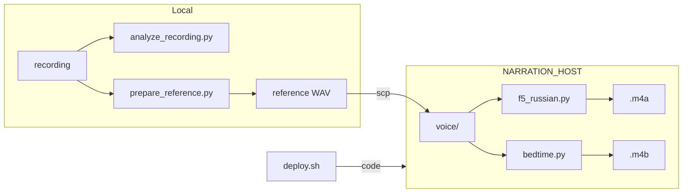

# Narration

Books read aloud in a voice you record. English uses Chatterbox. Russian uses F5-TTS. The render machine is whatever you set as `NARRATION_HOST`. This folder holds the code and the stories. It does not hold a voice file.

## Status

| Language | Engine | Settings | Output |
|---|---|---|---|
| English | Chatterbox 0.1.7 | `bedtime.py` defaults: exaggeration 0.3, guidance 0.5, speed 0.85 | One `.m4b` with chapter marks |
| Russian | F5-TTS 1.1.22 and `Misha24-10/F5-TTS_RUSSIAN` | `config/russian-standard.json` | One `.m4a`. Night and morning profiles. Optional music bed. |

The Russian checkpoint is CC BY-NC 4.0. Download it yourself. See [RUSSIAN_STANDARD.md](RUSSIAN_STANDARD.md).

## Set the host

```sh
export NARRATION_HOST=your-render-machine
export NARRATION_DEST=bedtime-audiobooks
```

`deploy.sh` and `build_story.sh` refuse to run until `NARRATION_HOST` is set. They have no default host. Set `NARRATION_PYTHON` when the Python on that machine is not `~/miniforge3/envs/bedtime/bin/python`.

If a systemd user service holds the GPU, name it. Otherwise the GPU script stops nothing.

```sh
export GPU_HOLD_SERVICE=your-gpu.service
```

## Files

| File | Where it runs | Purpose |
|---|---|---|
| `bedtime.py` | Render machine | English book to `.m4b`. |
| `gpu-run.sh` | Render machine | One GPU job. Stops `GPU_HOLD_SERVICE` only when that variable is set. |
| `f5_russian.py` | Render machine | Russian text to `.m4a`. |
| `russian_quality_loop.py` | Render machine | Renders, checks each part with Whisper, retries weak parts. |
| `build_story.sh` | Your computer | Ship, build, pull one story. |
| `story_build.py` | Render machine | Mode, critic, render, seams, loudness, gate. |
| `story_values.py` | Both | Values record and word lint. |
| `stress_check.py` | Your computer | Two stress engines and a review list. |
| `story_logic_review.py` | Your computer | Whole-story continuity check. Needs a local model. |
| `prepare_reference.py` | Either | Builds the Russian reference clip from your recording. |
| `analyze_recording.py` | Either | Levels, noise floor and pauses. |
| `reading/` | Either | Scripts to read when you record. |
| `voice/`, `samples/` | Ignored | Your recordings. Never commit them. |



## Record

Follow [RECORDING_GUIDE.md](RECORDING_GUIDE.md). Then fill `config/russian-standard.json` as [RUSSIAN_STANDARD.md](RUSSIAN_STANDARD.md) describes. Leave `wav_sha256` empty until `prepare_reference.py` prints the clip hash. Paste that hash back. The renderer then refuses a different clip.

## Russian: one story

A story is a `.txt` file in `stories/`. The first line is the title. Then one sentence per line. A blank line ends a paragraph. Spell out numbers. Put `+` before the stressed vowel: `мол+око`.

```sh
narration/deploy.sh
ssh "$NARRATION_HOST"
cd ~/bedtime-audiobooks
ruaccent-env/bin/python add_stress.py stories/NAME.txt stories/NAME.stressed.txt
~/miniforge3/envs/bedtime/bin/python russian_quality_loop.py stories/NAME.stressed.txt \
  --out books-ru/NAME.m4a --mode nighttime --workers 2
```

Or, from your computer, after the stressed text exists:

```sh
narration/build_story.sh NAME
```

The audio lands in `~/Downloads/Russian-Story-NAME.m4a`.

Whisper checks letters. It cannot judge stress, warmth, noise or pace. Listen before you keep a file.

### Gates before you render

Run these in `narration/` on your computer. They do not need the render machine.

| Step | Command | What it proves |
|---|---|---|
| Values and content | `story_values.py check NAME --strict` | Word count, known characters, mode cues, no religious or obscene word, no fear word unless `allows_fear`, and a values record. |
| Stress draft | `stress_check.py vote NAME --house --write-stressed` | RUAccent marks every word. Silero fills bare words. The review file lists the words where they differ. |
| Dictionary | `wiktionary_forms.py LEMMA` | A disputed stress mark is settled from the lemma, not from a guess. |
| Logic | `story_logic_review.py NAME` | A local model quotes continuity and wording problems. A quote that is not in the line is rejected. |

The stress command needs a pin, or RUAccent cannot download its models:

```sh
uv run --no-project --python 3.11 --with ruaccent --with silero-stress --with "huggingface_hub==0.25.2" \
  python stress_check.py vote NAME --house --write-stressed
```

On 5,975 words that need a mark, RUAccent agreed with the hand marks 97.19 percent of the time. Silero agreed 98.34 percent. The two-engine list held most of the RUAccent errors. `udarenie` is not used. Its install is broken.

A hand decision is not proof. Check a disputed word in a dictionary.

## English

Put a 10 to 60 second clean recording at `$NARRATION_DEST/voice/reference.wav` on the render machine. Without that file, Chatterbox uses its built-in voice.

```sh
ssh "$NARRATION_HOST"
~/bedtime-audiobooks/gpu-run.sh BOOK.epub
```

CPU only, about 3 times slower than real time:

```sh
~/miniforge3/envs/bedtime/bin/python ~/bedtime-audiobooks/bedtime.py BOOK.epub
```

Both accept `.epub` or `.txt`. The output is `~/bedtime-audiobooks/books/<name>.m4b`. Copy it back with `scp`. Knobs: `--exaggeration 0.3`, `--cfg 0.5`, `--speed 0.85`, `--chapters 1-3`.

## Environments

Run this on the render machine. The script creates three environments. It does not stop a service.

```sh
narration/setup_render.sh
source ~/bedtime-audiobooks/env.sh
```

Add `--with-model` to download the Russian speech weights. Those weights are CC BY-NC 4.0. Do not sell output that depends on them.

| Env | Holds |
|---|---|
| `$NARRATION_DEST/bedtime` | Python 3.11, torch 2.6.0, chatterbox-tts 0.1.7, transformers 4.46.3. `setuptools` stays below 81. |
| `$NARRATION_DEST/f5-env` | Shares the bedtime packages. Adds `f5-tts` 1.1.22, torchcodec 0.2.1 and pyarrow 21.0.0. |
| `$NARRATION_DEST/ruaccent-env` | `ruaccent`, with `huggingface_hub` 0.25.2. |

`ffmpeg` and `rubberband` stay outside the environments. The script names the install command when either tool is absent.

`env.sh` sets `NARRATION_PYTHON` to `$NARRATION_DEST/bedtime/bin/python`. The shell scripts still accept `~/miniforge3/envs/bedtime/bin/python` when that variable is unset.

Model files sit in `~/.cache/huggingface`. The F5 revision is pinned in the config.

## Privacy

A voice recording is biometric data. Recordings, references and rendered audio stay out of git. `.gitignore` blocks `voice/`, `samples/`, `books/`, `books-ru/` and the audio extensions. Do not commit a hash of a private recording to a public fork.
